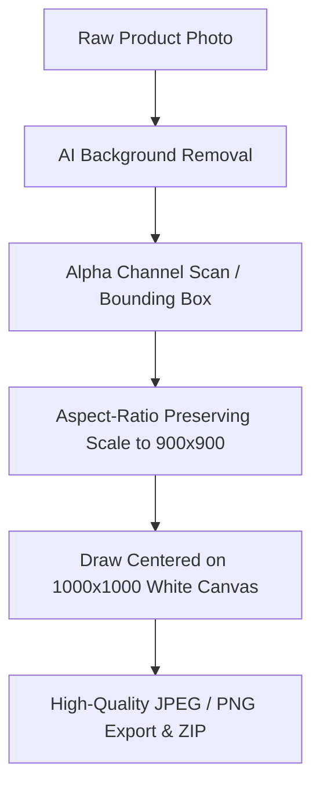

# Catalog Picture Studio 🛍️

A JavaScript application hosted on **Cloudflare Workers** that automatically removes the background from product photos using client-side AI and centers each item on a pristine **1000×1000 px white square canvas** for e-commerce catalogs.

---

## ✨ Features

- **⚡ Cloudflare Worker Deployment:** Hosted at the edge with static asset streaming and fast global latency.
- **🧠 100% Free Client-Side AI:** Powered by `@imgly/background-removal` running directly in the browser via WebAssembly/WebGPU. No API keys, no monthly fees, and no server timeouts.
- **🎯 Precision Centering Engine:**
  - Scans alpha channels to detect the exact tight bounding box around the product cutout.
  - Trims away all dead margins.
  - Scales proportionally to fit within 900×900 px (10% standard catalog padding).
  - Positions the product at the exact center $(500, 500)$ of a 1000×1000 white square canvas.
- **📦 Batch Queue & ZIP Export:**
  - Drag-and-drop batch upload supporting dozens of images.
  - Interactive status badges: *Queued*, *Downloading Model*, *Extracting Product*, *Centering*, *Completed*.
  - Toggle between original photo and 1000×1000 white catalog result on any card.
  - One-click **"Download All as ZIP"** bundled with clean e-commerce naming (`[product]_catalog_1000x1000.jpg`).
- **🎛️ Real-Time Sizing & Formatting Controls:**
  - **Resolution:** 1000×1000 (standard), 800×800, 1200×1200, 1500×1500.
  - **Padding Slider:** 5% to 25% edge margin.
  - **Background Fill:** Pure White (`#FFFFFF`), Off-White (`#F8F9FA`), Warm White (`#FAF7F2`), or Transparent PNG.
  - **Format:** JPEG (92% quality), PNG (lossless), or WebP.

---

## 🚀 Quick Start

### 1. Install Dependencies
```bash
npm install
```

### 2. Start Local Development Server
```bash
npm run dev
# or
npx wrangler dev
```
Open the provided local URL (typically `http://localhost:8787`) in your browser.

### 3. Deploy to Cloudflare Workers
```bash
npm run deploy
# or
npx wrangler deploy
```

---

## 📁 Project Structure

```
e:\catalog-pictures/
├── wrangler.toml              # Cloudflare Worker configuration
├── package.json               # Dependencies & scripts
├── src/
│   └── worker.js              # Worker entry point & edge routing
└── public/
    ├── index.html             # UI structure & SEO metadata
    ├── style.css              # Glassmorphic dark design system
    ├── app.js                 # Batch queue controller & ZIP packager
    ├── image-processor.js     # Alpha trimming & 1000x1000 centering engine
    └── bg-remover.js          # AI background removal abstraction
```

---

## 🛠️ Image Processing Pipeline



---

## 📄 License
MIT
